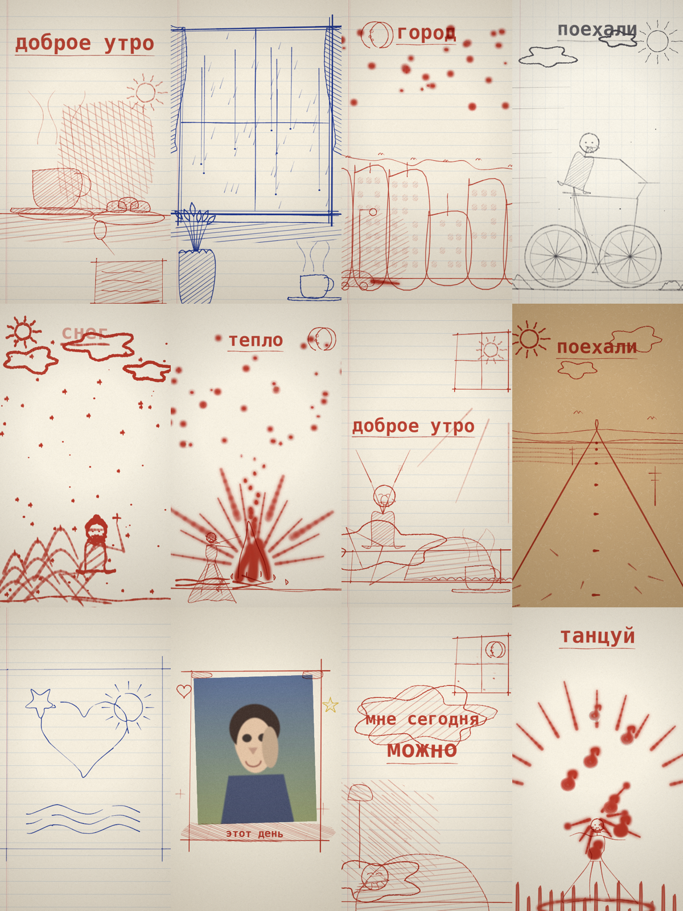
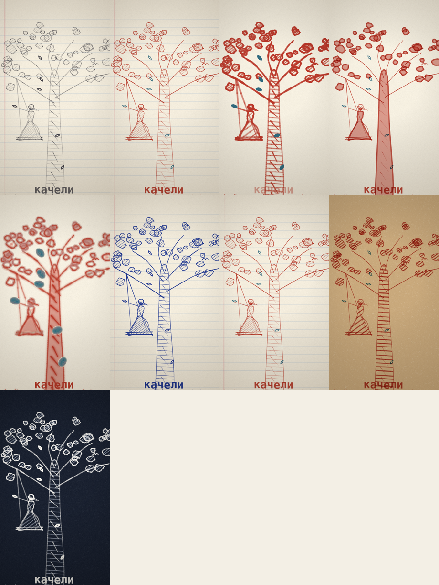
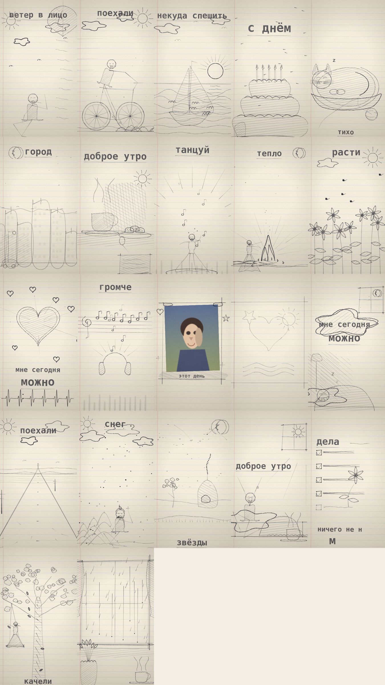
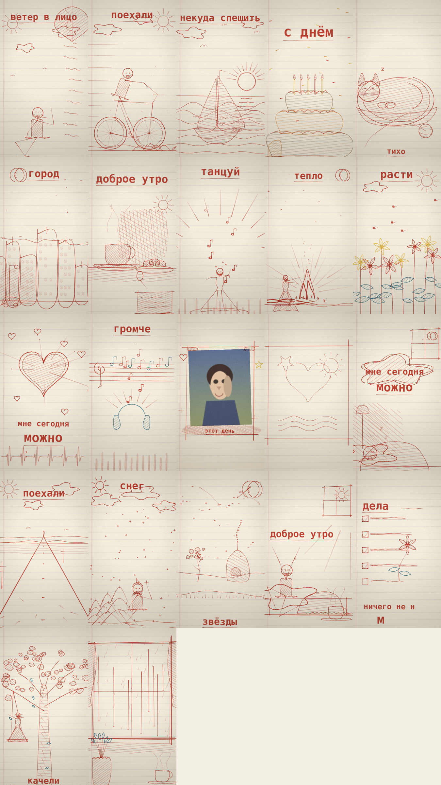

# 🖊️ Чернильный клип — движок рисованных клипов

Клип собирается **из твоего трека**: код слушает музыку (биты, удары, энергия и — по желанию —
**слова через Whisper**), сам раскладывает рисованные сцены по времени и записывает готовый mp4 —
прямо на устройстве, без сервера и без платных нейросетей.

Ни одного кадра видеогенерации: линия, нажим, зерно бумаги, чернила, карандаш, фломастер —
всё это нарисовано кодом на Canvas2D. Вдохновлено клипом «Мне сегодня можно»
(Андрей Овчаренко): идея и техника — оттуда, код написан с нуля.



---

## Как запустить

Нужен только браузер и любой локальный сервер (ES-модули не грузятся с `file://`).

```bash
node server.mjs          # http://localhost:8000
# или
python3 -m http.server 8000
```

Открыть адрес — и всё. Никаких `npm install`, сборщиков и зависимостей: чистый JS + Canvas2D.

**Как выложить в интернет:** это статические файлы — папку можно положить на GitHub Pages,
Netlify, Vercel или любой хостинг статики. Тогда клипы можно делать с телефона.

**Приложение для Android:** готовый APK — `apk/чернильный-клип-0.5.apk` (41 МБ: вместе с моделью
Whisper внутри, распознаёт в самолёте). Пересобрать самому:

```bash
npm install                 # Capacitor + плагины (тут же лежат в package.json)
npm run android:apk         # соберёт www/, синхронизирует и соберёт APK
# результат: android/app/build/outputs/apk/debug/app-debug.apk
```

Нужны Java 17 и Android SDK (`ANDROID_HOME`). Подробно, включая установку APK на телефон и
подпись для Google Play — `docs/ANDROID.md`.

**Скачивание клипа.** После записи файл сохраняется сразу, и рядом с плеером появляется кнопка
«💾 Сохранить клип ещё раз». Если браузер не дал скачать автоматически (так бывает во встроенных
предпросмотрах и на iPhone) — нажми её или «открыть в новой вкладке». В Android-приложении клип
падает в «Документы» без всяких разрешений. Клипы считаются на телефоне и сохраняются
в «Документы» (в браузере — обычное скачивание).

**Как веб-приложение (PWA):** в проект добавлены `manifest.json`, `sw.js` и иконки — папку можно
выложить на GitHub Pages / Netlify, открыть на телефоне и **поставить на домашний экран**;
после первого открытия интерфейс работает и без сети (модель Whisper кэшируется браузером).

---

## Что умеет

| Раздел | Что есть |
| --- | --- |
| **Материалы (9)** | простой карандаш, цветные карандаши, восковые мелки, маркер, цветные фломастеры, шариковая ручка, смешанная техника (линер + цветные), гуашь, мел по тёмному листу |
| **Бумага (5)** | тетрадь в линейку, чистый лист, клетка, крафт, тёмный лист |
| **Палитры (5)** | тёплая, холодная, яркая, мягкая, ночная |
| **Настроение** | утро / день / вечер / ночь — меняет свет, палитру и количество деталей |
| **Плотность** | ползунок 0.5–1.6: сколько мелочи сыпать (капли, листья, звёзды, конфетти) |
| **Сборка** | **Автомат** — сам ставит сцены по битам и энергии; **По сценарию** — ты задаёшь сцены словами, остальное добирает автомат |
| **Переходы** | листание страницы дневника, встык, авто |
| **Вариант** | кнопка 🎲 — другой сид: другие сцены, другой порядок, другой рисунок внутри сцен |
| **Сцены** | 22 сцены (20 рисованных + 2 из твоих картинок), клик по названию — посмотреть одиночно |
| **Свои картинки** | загрузка фото/рисунка: **полароид** — фото в рисованной рамке со скотчем; **обводка** — картинка превращается в контуры и рисуется на глазах (можно выбрать режим «линии» или «края» и степень детализации) |
| **Трек** | mp3 / wav / m4a / ogg: биты, темп, удары и энергия считаются на устройстве (БПФ + автокорреляция) |
| **Слова трека (Whisper)** | распознавание текста песни **на устройстве**: модели tiny/base/small, язык сам или руками; слова с точным временем → кнопка «сценарий по словам» расставляет сцены по ключевым словам («дождь» → дождь, «море» → лодка…) |
| **Экспорт** | mp4 (или webm, если браузер не умеет mp4) в 540×960 / 720×1280 / 1080×1920, в реальном времени, со звуком; кнопка **«⬇ Скачать клип (mp4)»** прямо под плеером, а после записи — «💾 Сохранить клип ещё раз» и «открыть в новой вкладке»; плюс сохранение кадра в PNG |



---

## Язык сценария

Сценарий — это обычные строки. Всё, что не указано, автомат дозаполнит сам.

```
стиль: цветные          # карандаш | цветные | фломастеры | ручка | смешанная | мел
бумага: клетка          # тетрадь | чистый | клетка | крафт | тёмный
палитра: яркая          # тёплая | холодная | яркая | мягкая | ночная
настроение: вечер       # утро | день | вечер | ночь
плотность: 1.2
переход: листать        # листать | встык | авто
вариант: 7              # число или слово — тот же клип собирается одинаково

# дальше — сцены. Время необязательно.
кот                     # подряд, как идёт
дождь 0:24              # начать на 0:24
шарик 0:40-0:55         # ровно этот отрезок
торт свечей: 5          # с параметром
картинка: мой день      # полароид с твоим фото и подписью
обводка 0:48-1:02       # твой рисунок рисуется линиями
финал
```

Своя картинка появляется в клипе двумя способами: `картинка` — фото в кадре (полароид),
`обводка` — рисунок, который клип обводит линиями. Подпись задаётся тут же:
`картинка: наш июль`. Файл выбирается на панели «Свои картинки».

Правила:

* время в формате `0:24` (минуты:секунды) или `24с`;
* если время у двух сцен пересекается — побеждает явно указанное, предыдущая обрезается;
* между указанными сценами автомат вставляет свои, подходящие по энергии этого места;
* в конце, если осталось место, ставится финал («фраза-подушка»);
* всё выравнивается по долям трека.

---

## Whisper: слова трека → сцены

Панель **«Слова трека — Whisper»**. **Модель уже внутри приложения** — ничего скачивать не надо,
интернет не нужен вообще (ни библиотека, ни модель, ни wasm-движок не ходят в сеть).

1. Загрузи трек в панели «Музыка» (он же нужен для битов).
2. Модель: `tiny` — уже внутри (44 МБ, вложена в приложение и APK). Если хочешь точнее,
   `base` (~80 МБ) или `small` (~260 МБ) — эти два докачаются один раз и лягут в кэш браузера/телефона.
3. **«распознать слова»** — идёт загрузка с прогрессом, потом распознавание. Видно текст и
   слова с временем; считает на видеокарте (WebGPU), а если её нет — на процессоре.
4. **«сценарий по словам»** — слова прогоняются через словарь: услышали «дождь» — ставим сцену
   дождя в это время, «море» — лодку, «костёр» — костёр и так далее. Получается готовый сценарий,
   который можно править руками. Всё, что словарь не покрыл, добирает автомат.

Это честный словарь, а не ИИ: работает мгновенно и бесплатно. «Понимающий» разбор (LLM, которая
собирает сценарий по смыслу текста) — следующий шаг, см. `docs/ROADMAP.md`.

Проверено на записи Джона Кеннеди (11 с, английский) **с полностью выключенным интернетом**:
модель загрузилась из приложения, 22 слова со временем, текст дословно, 6 секунд на 2 ядрах;
внешних запросов — ноль.

---

## Библиотека сцен



| id | Название | Что происходит |
| --- | --- | --- |
| `window_rain` | Дождь за окном | шторы, капли бегут по стеклу, растение и чай на подоконнике |
| `cat_sleep` | Кот спит | кот дышит во сне, хвост метётся, «с-с-с», клубок с ниткой |
| `city_night` | Город вечером | дома, окна загораются и мигают, провода с птицами, машина, фонарь |
| `stars` | Звёзды | звёзды поют, созвездие, падающая звезда, домик с дымом, дерево |
| `coffee` | Кофе | чашка, пар, печенье, записка и «доброе утро» |
| `bicycle` | Велосипед | крутятся колёса и педали, девочка едет, кусты уезжают назад, ветер |
| `tree_swing` | Дерево и качели | листва, качаются качели, прилетает птица, падают листья |
| `heart` | Сердце | пульсирует в такт, искры на удары, кардиограмма, «мне сегодня можно» |
| `boat` | Лодка и море | солнце, отражение, волны, лодка качается, чайки |
| `balloon` | Воздушный шарик | девочка держит шарик, отпускает на «ветер в лицо», машет вслед |
| `flowers` | Цветы | стебли растут на глазах, раскрываются цветы, летают пчёлы |
| `music` | Ноты и наушники | скрипичный ключ, ноты прыгают в такт, наушники, эквалайзер |
| `dance` | Танец | танцующая фигура, лучи, ноты, эквалайзер по ударам |
| `todo` | Список дел | дела зачёркиваются, последнее превращается в цветок |
| `cake` | Торт со свечами | ярусы, свечи с огнём, конфетти, кусок на тарелке |
| `pillow` | Финал: фраза-подушка | штора-облако вокруг фразы, спящая под одеялом, торшер, «с-с-с» |
| `snow` | Снег | ёлки в снегу, падает снег, девочка в шапке со снежинкой на рукавице |
| `fire` | Костёр | языки пламени, искры вверх, девочка греет руки, тёплое свечение |
| `road` | Поехали | шоссе к горизонту, разметка бежит на зрителя, столбы, солнце |
| `stretch` | Доброе утро | потягивается у окна, солнце за шторой, одеяло, кружка и цветок |
| `my_photo` | Моя картинка: полароид | твоё фото в кадре со скотчем и подписью, вокруг рисуются мелочи |
| `my_trace` | Моя картинка: обводка | твой рисунок/фото: линии прорисовываются сверху вниз, тени штриховкой |



---

## Своя сцена — это ~20 строк

Файл `src/scenes1.js` или `scenes2.js`, добавить объект в массив:

```js
const my_scene = {
  id: 'my_lamp', name: 'Лампа', dur: 12,
  draw(p, t, S) {
    // t — секунда внутри сцены; S.params — параметры из сценария; S.pulse(t) — сила удара
    p.line(200, 1600, 200, 900, { t0: .2, t1: 1.0 });          // ножка лампы
    p.shape([[140, 900], [300, 900], [260, 800], [180, 800]],   // абажур с заливкой
      { closeShape: true, fill: 'fill', stroke: 'main', spacing: 20, t0: .6, t1: 1.8, c: 1 });
    const glow = Math.abs(Math.sin(t * 2));                     // свет «дышит»
    p.ray(220, 900, -Math.PI * .9, -Math.PI * .1, 120, 320 + glow * 60, 7,
      { role: 'accent', alpha: .35 + glow * .3, t0: 1.2, t1: 2.4, step: .06 });
    p.text('свет', 540, 1500, { size: 96, align: 'center', t0: 2.6, t1: 4.2, underline: true });
  },
};
```

Что доступно в сцене:

| Команда | Что делает |
| --- | --- |
| `p.ink(точки, o)` | линия по точкам (с нажимом, дрожью руки, сходом на конце) |
| `p.line / curve / poly / circle / ellipse / arc / rect` | простые фигуры |
| `p.shape(путь, {fill, stroke})` | фигура с заливкой-штриховкой и контуром |
| `p.text / p.zzz / p.scribed` | рукописный текст, «с-с-с», проверки в списке дел |
| `p.sun / moon / cloud / star / heart / leaf / flower / balloon / cup / note / bird / grape...` | готовые мелочи |
| `p.figure / p.person` | человек: позы, ИК-руки к предмету, шаг, танец, сидя |
| `p.shade` | тень-штриховка без контура |
| готовые блоки | `equalizer`, `notesFlying`, `sparkBurst`, `dust`, `skyStars`, `foliage`, `bushes`, `scribbleText`, `waves` |

Тайминг: у каждой команды `t0` / `t1` — секунды внутри сцены, когда штрих появляется
(по умолчанию — сразу). `p.seq(i, t0, step, dur)` — очередь появления для серии.

**Роли и цвета.** Сцена говорит только роль — `main` (главная линия), `fill` (заливка),
`accent` (акцент) — и цвет (`c: 0…6` из палитры). Чем это нарисовать, решает профиль:
поэтому один и тот же клип переключается между карандашом, фломастерами и ручкой
**без единой правки в сценах**.

---

## Файлы

| Путь | Что это |
| --- | --- |
| `index.html` | экран: превью, палитра настроек, сценарий, библиотека сцен, план клипа, экспорт |
| `src/materials.js` | нажим, штрих, слои материала, заливка-штриховка, зерно бумаги |
| `src/paper.js` | тайл бумаги (волокна, зерно), линовка/клетка/поле, дырокол, виньетка |
| `src/api.js` | «рука» сцены: `ink/shape/text/figure/…` + ИК + позы |
| `src/util.js` | математика, шум, сплайны, фигуры (сердце, звезда, облако), ИК |
| `src/scenes1.js`, `src/scenes2.js` | 16 сцен |
| `src/scenes3.js` | сцены снег/костёр/дорога/утро + сцены из своих картинок |
| `src/image.js` | разбор картинки: серое, размытие, Собель, пороги, скелет, линии, штриховка тени |
| `src/native.js` | сохранение клипа на телефон (Capacitor) или скачиванием в браузере |
| `src/whisper.js` | Whisper на устройстве: локальная модель, 16 кГц, слова со временем, словарь «слово → сцена» |
| `vendor/` | transformers.js 3.3.3 и движок ONNX (wasm) — лежат внутри, в сеть не ходят |
| `models/whisper-tiny/` | модель распознавания (44 МБ) — внутри приложения и внутри APK |
| `build-www.mjs`, `capacitor.config.json`, `android/` | сборка Android-приложения |
| `manifest.json`, `sw.js`, `icon-*.png` | установка как приложение (PWA) и офлайн-кэш |
| `src/common.js` | общие кирпичи: настроения, звёзды, искры, листва, человек по суставам |
| `src/audio.js` | анализ трека: БПФ, поток ударов, темп, сетка долей, энергия |
| `src/script.js` | разбор сценария словами |
| `src/timeline.js` | раскладка: автомат + сценарий, привязка к долям, финал |
| `src/render.js` | сборка кадра, камера (дыхание, качание по ударам), переворот страницы |
| `src/export.js` | запись клипа (Canvas + MediaRecorder), сохранение файла |
| `server.mjs` | локальный сервер для запуска |
| `docs/` | витрина и контактные листы |
| `samples/` | картинки для опытов с загрузкой |
| `test120.wav` | синтетический трек 120 BPM — проверка анализа |

---

## Проверено

* анализ трека: на тестовом треке 120 BPM даёт **120.2 BPM**, доли каждые 0.499 с, находит удары;
* рисование: все 22 сцены отрисованы во всех 9 материалах без ошибок;
* обводка: чистый рисунок разбирается по линиям (25 линий, 0.2 с), фото — по краям; имя режима
  видно в панели «Свои картинки»;
* Whisper офлайн (интернет заблокирован в браузере): 11-секундная запись — 22 слова со временем, текст дословно, 6 с, внешних запросов 0;
* скачивание клипа проверено и во встроенном предпросмотре (iframe с sandbox): файл записывается, кнопка «Сохранить клип ещё раз» появляется;
* сценарий из слов: «дождь 0:03», «люблю 0:09», «город 0:20», «костёр 0:33» — словарь расставляет сцены сам;
* APK: собран `apk/чернильный-клип-0.5.apk`, 41 МБ (модель Whisper внутри), `ru.inkclip.app`, Android 5.1+;
* 0.5: распознавание речи без единого скачивания (всё внутри), устойчивость к вылетам
  (распознавание в отдельном потоке + освобождение памяти + 540p по умолчанию на телефоне),
  «Скачать клип» появляется только после готового клипа, кнопка ⏹ в плеере останавливает и возвращает в 0:00;
* сценарий: `обводка 0:10-0:22`, `картинка: мой день`, `костёр 0:40` раскладываются по времени
  без предупреждений, промежутки дозаполняются автоматом;
* экспорт: записан mp4 720×1280, читается плеером (длительность и размеры определяются);
* переворот страницы: кадр в середине перехода содержит и уходящую, и входящую бумагу;
* производительность (2 медленных ядра, headless Chrome): превью 540×960 — ~65 мс/кадр,
  1080×1920 — ~100 мс/кадр; на телефоне идёт медленнее, поэтому в экспорте по умолчанию 720p.

---

## Что дальше

1. **LLM поверх слов** (по желанию): маленькая модель в браузере (WebLLM/Qwen) собирает сценарий
   по смыслу текста, а не по словарю; облачная — придумывает новые сцены. Сейчас работает словарь.
2. **Свой рисунок как герой**: нарисованный человечек оживает — отдельный большой проект.
3. Ещё сцены (цель 25–30) и материалы: акварель, штампы, мятая бумага.
4. Подпись APK для Google Play и публикация. 

---

## Честные ответы

**Это бесплатно?** Да. Рисует код, поэтому себестоимость клипа — ноль, интернета не нужно,
ограничений на количество нет. Платным был бы только сервер для рендера (не нужен) и
публикация в Google Play (25 $ один раз).

**Почему mp4, а не webm?** Какой формат запишет браузер, такой и будет: Chrome/Android обычно
mp4, часть браузеров — webm. Файл в обоих случаях играется везде.

**Рендер в реальном времени?** Да: клип на 1 минуту записывается примерно минуту. Это плата за
то, что всё считается на устройстве и бесплатно. Для 1080×1920 лучше экспортировать на компьютере.

**Про оригинал.** Репозиторий-вдохновитель: `rocketmandrey/mne-segodnya-mozhno`. Здесь ни одной
строки оттуда: своя бумага, свой штрих, свои сцены, свой анализ звука. Идеи и техники
(рисование кодом, попадание в ударные слоги, «рука» на штрихе) авторским правом не защищены —
защищён конкретный код, поэтому эта реализация написана с нуля.

---

## Версия 0.6: сёрфер и рендер в Node

1. **9 новых сцен** (`src/scenes4.js`) — Эйси, кислотный сёрфер: стойка, отжимания,
   взгляд, горизонт, волна, полёт, робот, отдых, свет. Слова для сценария:
   `стойка, отжимания, взгляд, горизонт, волна, полёт, робот, отдых, свет`
   (см. `clips/surfer.txt` — готовый сценарий клипа «Beautiful Far Distance»).
2. **Рендер без браузера** (`tools/render-node.mjs`): тот же движок рисует
   на `@napi-rs/canvas`, звук анализирует `analyzeBuffer`, кадры собираются
   в mp4 через ffmpeg. Быстрый контроль: `tools/contact.mjs`
   (по кадру из сцены), `tools/probe-frame.mjs` (поиск NaN в координатах).
3. Мелочи движка: у `p.shape` — отдельный `strokeColor` (заливка и контур
   разного цвета); `sparkBurst`, `dust`, `skyStars` принимают `c` (цвет из палитры).

### Клип «Beautiful Far Distance» (сёрфер, фломастеры, 2:50)

```bash
npm install                                    # нужен только @napi-rs/canvas
pip install imageio-ffmpeg                     # даёт бинарник ffmpeg
node tools/render-node.mjs \
  --script clips/surfer.txt \
  --audio clips/audio-beautiful-far-distance.mp3 \
  --out output/surfer-720p.mp4 --size 720x1280 --fps 30
```

Рендер однопоточный (~4 кадра/с на 540p): длинный клип быстрее считать
кусками по границам сцен и склеить:

```bash
node tools/render-node.mjs --script clips/surfer.txt --audio clips/audio-beautiful-far-distance.mp3 \
  --out output/a.mp4 --size 720x1280 --from 0 --to 55.1
# ... b.mp4 (55.1–118.9), c.mp4 (118.9–170) — параллельно
ffmpeg -i output/a.mp4 -i output/b.mp4 -i output/c.mp4 -filter_complex \
  "[0:v][0:a][1:v][1:a][2:v][2:a]concat=n=3:v=1:a=1" output/surfer-720p.mp4
```

### Про папку `models/`

Модель Whisper (`models/whisper-tiny`, 44 МБ) в git не входит — она лежит
в архиве `inkclip-v0.5.zip` на Диске. Без неё работает всё, кроме распознавания слов.
